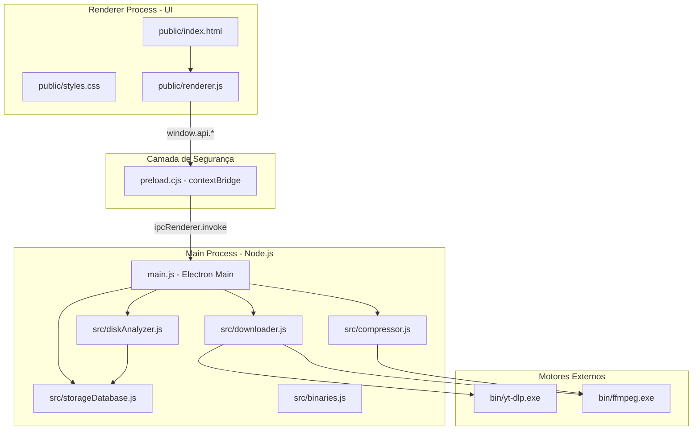

# 📚 Documentação Técnica — DowSpace Studio

Bem-vindo à documentação oficial do **DowSpace Studio**! Este diretório contém a referência técnica de desenvolvimento, arquitetura de software, fluxo de dados e detalhamento dos módulos de código.

---

## 🧭 Índice da Documentação

1. **[Arquitetura do Sistema](arquitetura.md)**
   - Modelo de Processos do Electron (Main Process, Preload e Renderer Process).
   - Protocolo de Comunicação Segura via IPC (`contextBridge`).
   - Ciclo de Vida da Aplicação e Janelas.

2. **[Módulos do Backend (Node.js / Core)](modulos-backend.md)**
   - `src/downloader.js`: Metadados do YouTube, streaming de download, seleção de resolução e conversão H.264 para NLEs (After Effects e Premiere).
   - `src/compressor.js`: Motor de compactação inteligente em 2 passos (2-Pass Encoding), cálculo de bitrates para MB alvo e CRF presets.
   - `src/diskAnalyzer.js`: Analisador de armazenamento do Windows, medição recursiva, detecção de vídeos gigantes e integração com a Lixeira do Windows.
   - `src/storageDatabase.js`: Camada de persistência local em JSON com cache para navegação instantânea.
   - `src/binaries.js`: Gerenciamento, verificação e download automatizado do `yt-dlp.exe` e `ffmpeg.exe`.
   - `src/ui.js`: Utilitários de formatação de bytes, duração e interface de linha de comando (CLI).

3. **[Interface do Usuário & Frontend](interface-frontend.md)**
   - Estrutura do DOM e Navegação em Abas (`public/index.html`).
   - Controlador de Interface e Lógica de Eventos (`public/renderer.js`).
   - Design System, Glassmorphism, Temas Claro/Escuro e Responsividade (`public/styles.css`).
   - Algoritmo de Visualização Hierárquica em Treemap (estilo SpaceSniffer).

4. **[Guia de Instalação, Build e Empacotamento](guia-instalacao-e-build.md)**
   - Como executar o projeto localmente em desenvolvimento.
   - Como gerar o executável nativo do Windows (.exe).
   - Como funciona o instalador automatizado (`scripts/install.ps1` e `instalar.bat`).
   - Como compilar instaladores com Inno Setup (`installer/DowSpace-Studio.iss`).

---

## 🏛️ Visão Geral da Arquitetura

O **DowSpace Studio** foi projetado seguindo uma arquitetura modular desacoplada:

---

## 🛠️ Tecnologias Utilizadas

- **Runtime & Desktop Framework:** Node.js (v20+) & Electron (v45)
- **Motores de Mídia:** FFmpeg 6.1 (x64) & yt-dlp (Latest Release)
- **Interface Gráfica:** HTML5 Semântico, CSS3 Moderno (Custom Properties, Flexbox, Grid) e Vanilla JavaScript ES6+
- **Segurança:** Isolamento de contexto ativado (`contextIsolation: true`), `nodeIntegration: false` e `sandbox: false` para acesso aos utilitários de sistema operacional via APIs estritas.
